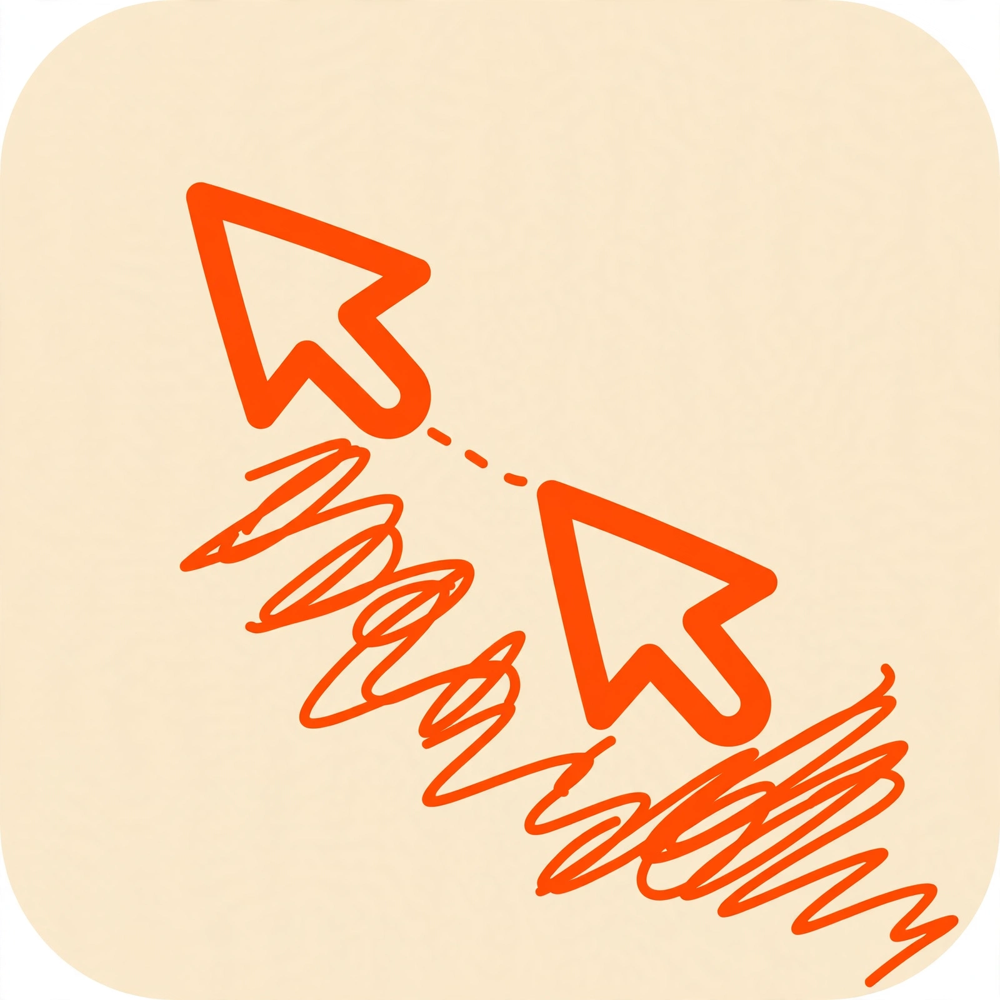
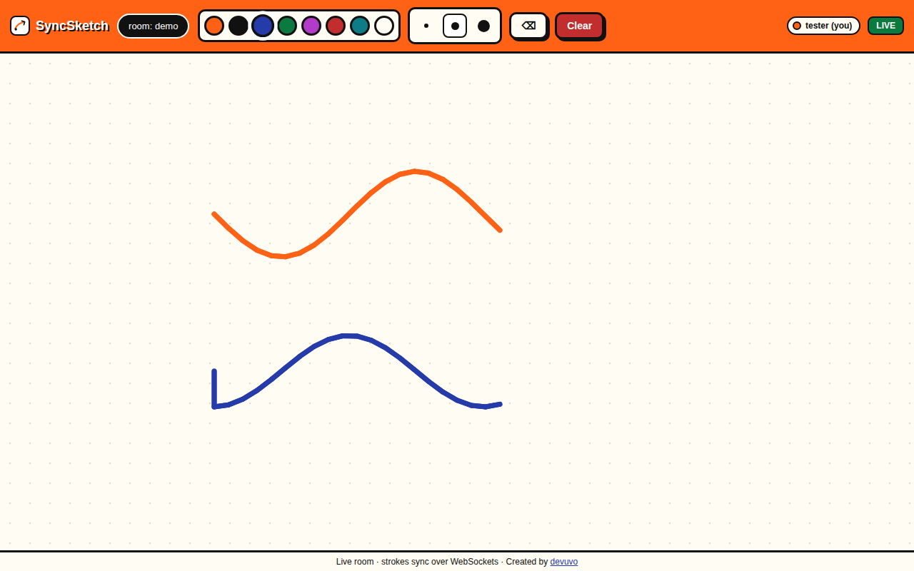
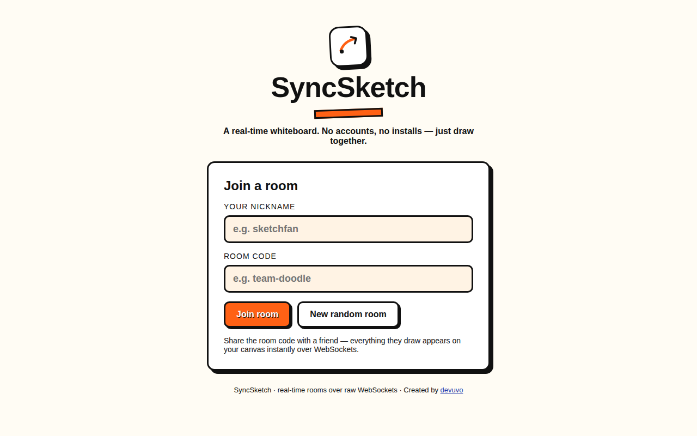

# SyncSketch

[](LICENSE)
[](server.js)
[](test/socket.test.js)



*Created by devuvo*

A real-time collaborative whiteboard over **raw WebSockets** — no accounts, no installs. Open a room, share the code, and everything anyone draws appears on every canvas instantly. Built with Node.js + `ws` (the real protocol, not a wrapper) and a zero-dependency canvas frontend.




## Design

- **Style:** Neo-brutalism — thick black borders, flat bold colors, chunky shadows, playful on purpose (it's a drawing app)
- **Palette:** #7 **Neon Orange** `FF6115` + **Porcelain** `FFFCF4`

## The protocol

One JSON frame type field, `t`. All frames are size-capped (64 KB) and shape-validated; malformed frames are dropped silently.

**Client → server**

| Frame | Purpose |
|---|---|
| `{t:'join', room, name}` | Join (or create) a room |
| `{t:'stroke', room, stroke:{color,width,points[],eraser?}}` | Broadcast one finished stroke |
| `{t:'clear', room}` | Wipe the board for everyone |
| `{t:'cursor', room, x, y}` | Live cursor position (client-throttled to ~15/sec) |

**Server → client**

| Frame | Purpose |
|---|---|
| `{t:'init', strokes[], users[], you}` | Full board state + roster on join (late joiners catch up) |
| `{t:'stroke', stroke, from}` | A peer's stroke, drawn immediately |
| `{t:'clear', by}` | Board was wiped |
| `{t:'users', users[]}` | Presence roster (join + leave) |
| `{t:'cursor', from, name, color, x, y}` | A peer's live cursor |

**Server internals:** rooms live in a `Map` (code → `{strokes[], users, clients}`); stroke history is capped at 500 per room; empty rooms are deleted on last leave. Heartbeat ping/pong every 30 s drops dead connections. The client reconnects with exponential backoff (1 s → 15 s cap) and re-joins automatically.

## Run it

```bash
npm install
npm start        # http://localhost:8124
npm test         # 6 protocol tests against a live server
```

Open two browser windows at `http://localhost:8124`, join the same room code, and draw — strokes, cursors, and presence sync live.

## Files

```
syncsketch/
  server.js            # Express + ws: rooms, broadcast, heartbeat, validation
  public/
    index.html         # lobby: nickname + create/join room
    board.html         # canvas + toolbar + presence
    app.js             # canvas drawing, socket client, backoff reconnect
    style.css          # neo-brutalist theme
  test/socket.test.js  # 6 protocol tests (node:test, no framework)
```

## Security notes

- Every inbound frame is validated: room codes and nicknames are allow-listed, strokes must have a `#rrggbb` color, sane width, and 2–500 finite points within bounds.
- Frames over 64 KB are rejected at the `ws` layer (`maxPayload`).
- Unknown frame types are ignored. Click coordinates are rounded client-side to limit precision leakage.

## Limitations

- **Demo scope:** rooms live in server memory, so a restart wipes boards and only one server instance can hold a room. The scale path is Redis pub/sub between instances plus a persistent stroke store — the protocol wouldn't need to change.
- No authentication: anyone with a room code can draw (by design for a demo; a real deployment would add signed room tokens).
- No rate limiting on strokes yet beyond the per-stroke point cap.

## License

devuvo Community License v1.0 — see [LICENSE](LICENSE). Free for personal, educational, and non-commercial use with visible credit to devuvo; commercial use needs prior written approval at admin@devuvo.com.
